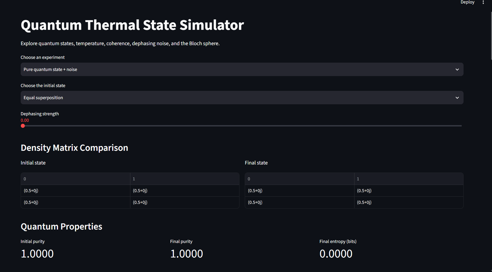
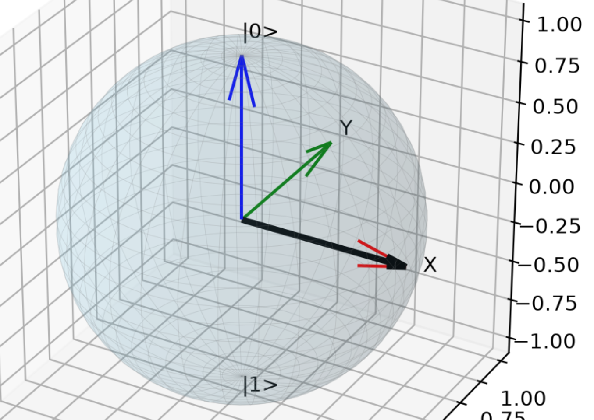
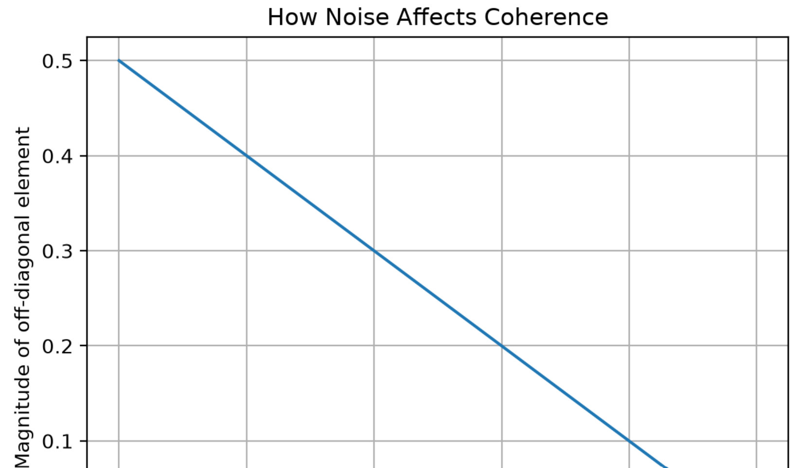
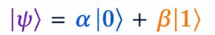
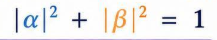
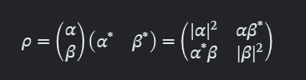
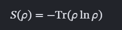
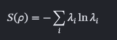
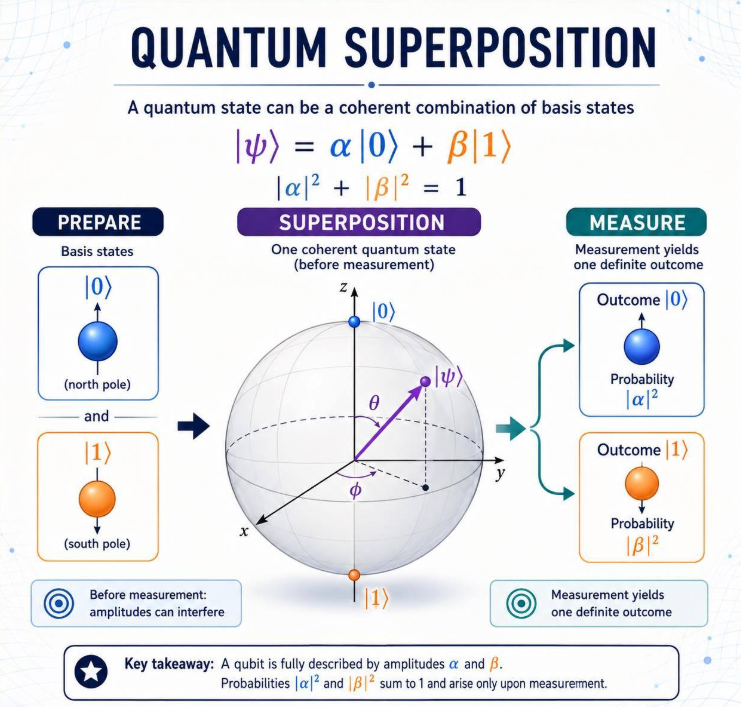

# Quantum State & Noise Explorer

An interactive quantum computing project for exploring **qubit states, density matrices, thermal states, quantum coherence, dephasing noise, and the Bloch sphere** using Python.

Built with NumPy, Matplotlib, and Streamlit, this project connects the mathematical representation of quantum states with visual simulations. Users can modify experimental parameters and observe how quantum properties change in real time.







## Overview

Quantum mechanics describes systems that can exist in superpositions of states. In realistic environments, interactions with the surroundings can introduce noise and reduce quantum coherence.

The **Quantum State & Noise Explorer** is designed to make these concepts easier to understand through interactive experiments.

The application currently supports two experiments:

1. **Pure Quantum State + Noise** — Create a qubit in an equal superposition or one of the computational basis states, apply dephasing noise, and observe the resulting changes.
2. **Thermal State** — Investigate how temperature affects the populations of a two-level quantum system.

For each experiment, the application displays density matrices, purity, von Neumann entropy, a coherence-versus-noise graph, and a 3D Bloch sphere visualization.

## Features

- **Density Matrix Visualization:** Compare initial and final quantum states.
- **Pure State Preparation:** Generate qubit states from probability amplitudes.
- **Thermal State Simulation:** Examine the effect of temperature on energy-level populations.
- **Dephasing Noise:** Control noise strength using an interactive slider.
- **Bloch Sphere:** Visualize quantum states as three-dimensional Bloch vectors.
- **Quantum Purity:** Measure how close a state is to being pure.
- **Von Neumann Entropy:** Quantify the mixedness of a quantum state.
- **Coherence Analysis:** Plot the magnitude of an off-diagonal density matrix element against noise strength.
- **Interactive Dashboard:** Explore the system through a Streamlit interface.

## Technology Stack

| Technology | Purpose |
|---|---|
| Python | Core programming language |
| NumPy | Matrix operations, eigenvalues, and numerical calculations |
| Matplotlib | Graphs and 3D Bloch sphere visualization |
| Streamlit | Interactive web application |

## Project Structure

```text
quantum-thermal-simulator/
│
├── app.py
├── physics.py
├── README.md
└── requirements.txt
```

- `app.py` — Streamlit interface, experiment controls, metrics, plots, and Bloch sphere.
- `physics.py` — Quantum-state construction, thermal-state calculation, purity, entropy, and dephasing.
- `requirements.txt` — Python dependencies.
- `README.md` — Project documentation, formulas, and setup instructions.

## Installation and Setup

### 1. Clone the repository

```bash
git clone <YOUR_GITHUB_REPOSITORY_URL>
cd quantum-thermal-simulator
```

Replace the repository URL with your GitHub repository URL.

### 2. Create a virtual environment

On Windows:

```bash
py -m venv .venv
.venv\Scripts\activate
```

On macOS or Linux:

```bash
python3 -m venv .venv
source .venv/bin/activate
```

### 3. Install dependencies

Create a `requirements.txt` file containing:

```text
numpy
matplotlib
streamlit
```

Then run:

```bash
python -m pip install -r requirements.txt
```

On Windows, you can use `py -m pip` if the `python` command is unavailable.

### 4. Launch the application

```bash
streamlit run app.py
```

Streamlit will provide a local URL, usually `http://localhost:8501`, where you can interact with the simulator.

## Mathematical Foundations

This project uses the density matrix formalism to represent quantum states and study how noise changes them.

### 1. Qubit State Representation

A pure qubit state can be represented as




A valid normalized qubit state satisfies




### 2. Density Matrix

The density matrix of a pure state is defined as



Here, (*) denotes complex conjugation.


### 3. Von Neumann Entropy

Von Neumann entropy quantifies the mixedness of a quantum state.

It is defined as



Equivalently, using the eigenvalues \(\lambda_i\) of the density matrix,



The implementation calculates the eigenvalues numerically and excludes values sufficiently close to zero to avoid evaluating \(\log_2(0)\).

Entropy and purity provide complementary information about the state. Dephasing an equal superposition increases its entropy and decreases its purity.

### 4. Bloch Sphere Representation

The Bloch sphere represents a single-qubit density matrix as a vector in three-dimensional space.




## Experiments to Try

### Experiment 1: Equal Superposition

1. Select **Pure quantum state + noise**.
2. Choose **Equal superposition**.
3. Set dephasing strength to zero.
4. Observe the Bloch vector on the positive X-axis.
5. Increase the dephasing strength.

Expected result: The Bloch vector moves toward the center, purity decreases, entropy increases, and the off-diagonal entries approach zero.

### Experiment 2: Computational Basis States

1. Select \(|0\rangle\).
2. Observe the Bloch vector at the north pole.
3. Change the dephasing strength.

Expected result: The state remains at the north pole because its off-diagonal entries are already zero.

Repeat with \(|1\rangle\), which lies at the south pole.

### Experiment 3: Thermal Equilibrium

1. Select **Thermal state**.
2. Start with a low temperature.
3. Gradually increase the temperature.

Expected result: The Bloch vector moves toward the center along the Z-axis as the two energy-level populations approach equality.


## Author --->> NAMIT SINGH

Developed as an educational project to explore the mathematical foundations of quantum states, quantum noise, and quantum information through interactive Python simulations.

---

**Quantum State & Noise Explorer** — connecting quantum mathematics with visual intuition.
